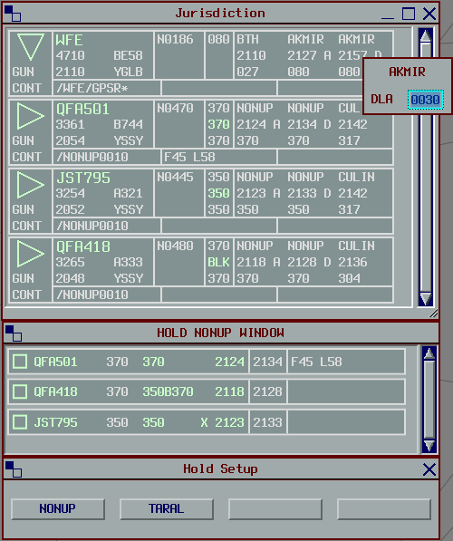
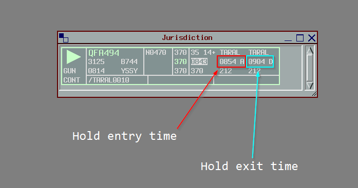
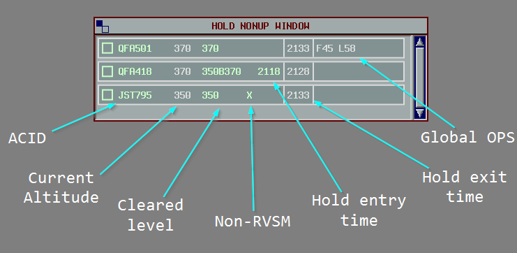

<h1 align="center">
  Hold Plugin
</h1>

<h3 align="center">
  A vatSys plugin adding a Eurocat-style Hold list, and delay functionality.

  [](https://github.com/YuKitsune/HoldPlugin/actions/workflows/build.yml)
  [](https://github.com/YuKitsune/HoldPlugin/blob/main/LICENSE)
  [](https://github.com/YuKitsune/HoldPlugin/releases)
  [](https://github.com/Fallout-build/Fallout)


  
</h3>

## Installation

Ensure you have [vatSys](https://virtualairtrafficsystem.com/) version 1.4.20 or later installed, and .NET Framework 4.7.2 or later.

1. Download the [latest release from GitHub](https://github.com/YuKitsune/HoldPlugin/releases)
2. Extract `HoldPlugin.dll` into your vatSys plugins directory:
   ```
   Documents\vatSys Files\Profiles\<Profile Name>\Plugins\HoldPlugin
   ```
3. Run `unblock-dlls.bat` (included in the zip) to unblock the DLL files
4. Open vatSys and confirm `Hold Setup` appears under the `Tools` menu

## Delays and Holds

A **delay** is a time that the aircraft stays at a waypoint on its route. The pilot gives the delay in the flight plan remarks with a `DLE/` remark (e.g. `DLE/TARAL0020` for 20 minutes at `TARAL`). Pilots usually use a delay for aerial work, such as survey or training flights that stay in one area before they continue on their route.

The plugin adds the delay to the arrival time at the waypoint, and to the `ETO`s of all the waypoints after it. A flight plan track (with no radar track) stays at the waypoint until the departure time. After the departure time, it continues along its route automatically. A delay does not stop a radar track, and the hold list does not show an aircraft with only a delay. A delay does not inhibit alerts.

A **hold** is similar to a delay, but it is initiated by ATC. The plugin adds the hold duration to the `ETO`s in the same way as a delay.
Holds differ from delays, in that:

- The hold list shows the aircraft.
- vatSys does not move the aircraft along its route past the hold point. The radar track or the flight plan track stays at the hold point.
- The plugin inhibits RAM, STCA, DAIW, and MSAW alerts for the aircraft.

A hold does not stop automatically, also after the departure time. The hold continues until the controller terminates it.

## Usage

### Changing a Delay

To change a delay, right-click the ETO of the waypoint in the strip (the arrival time or the departure time). Type the delay in the `HHMM` format, then press `ENTER`. If you type one or two digits, the plugin uses them as minutes. This changes the `DLE/` in the remarks.

> [!NOTE]
> Only the controller with jurisdiction of the aircraft can modify delays.

### Initiating a Hold

To initiate a hold, select the aircraft, place your mouse cursor on the position where the aircraft must hold, then press `F8`.

- If the cursor is near a waypoint on the route, the hold is at that waypoint.
- If the cursor is not near a waypoint on the route, the aircraft is re-routed to the cursor position to hold there.

The hold has a default length of 10 minutes.

You can change the `F8` key in `Settings` > `Keyboard`.

The hold has an effect on the ETOs as soon as it is in the flight plan.

> [!NOTE]
> Only the controller with jurisdiction of the aircraft can initiate, modify, and terminate a hold.

### Strip

When the flight plan has a delay or a hold, the waypoint appears twice in the strip:

- The first time shows the time of arrival at the waypoint, with an `A`. Before the aircraft gets to the waypoint, this is the `ETO`. After the aircraft gets to the waypoint, this is the `ATO`.
- The second time shows the departure time from the waypoint, with a `D`.



### Hold List

The hold list shows the aircraft configured for holding. The hold list shows only the aircraft in the `Jurisdiction`, `HandoverIn` or `HandoverOut` state. It does not show an aircraft with only a delay.

The hold list shows the flights ordered by their `CFL`.

The strip shows the hold entry and exit times. To change the exit time, click it, then select a new exit time.

You can also see and edit the `CFL` and `OP_DATA` from the hold label.



### Terminating a Hold

To finish a hold, either:

1. Middle-click the ACID in the hold list.
2. Select the aircraft, then press `F8`.
3. Re-route the aircraft past the hold point.

When a hold terminates:

- If the aircraft is in the hold, or the hold point is the next waypoint, the plugin adds a position report at the current position of the aircraft, and vatSys calculates the `ETO`s again from it. Thus the `ETO`s start at the actual time that the aircraft leaves the hold, and vatSys does not show a RAM alert. A flight plan track then continues along its route from the hold point.
- The aircraft is removed from hold list. If no other aircraft hold at that waypoint, the plugin frees the list (only for a list that the plugin created automatically).

### Configuring Lists

Up to 5 holding lists are available, 4 can be allocated to a specific waypoint, with 1 remaining for all other hold points.
When a hold is initiated at a waypoint that does not already have its own list, one is created automatically. When all holds at that waypoint are removed, the list is freed and the slot becomes available again.

Lists can also be configured manually via `Tools` > `Hold Setup`. Manually configured lists are not freed automatically; they must be cleared via the Hold Setup window.

Any aircraft holding at a waypoint other than one allocated to one of the 4 lists will be placed in the `OTHER` list.


## How it works

The plugin keeps the delays and the holds in the remarks of the flight plan:

- A delay from the pilot uses the standard `DLE/` format: `DLE/[waypoint][HHMM]`, where `HHMM` is the length of the delay. For example, `DLE/TARAL0020` is a delay of 20 minutes at `TARAL`.
- A hold from the controller uses the same format, with `HLD/`. For example, `HLD/TARAL0020` is a hold of 20 minutes at `TARAL`.

The remarks can have more than one delay, but only one hold. When you initiate a hold, the new `HLD/` replaces the old one.
